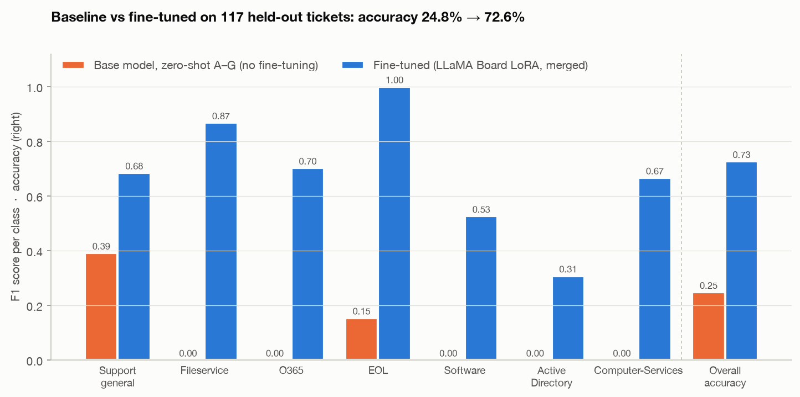
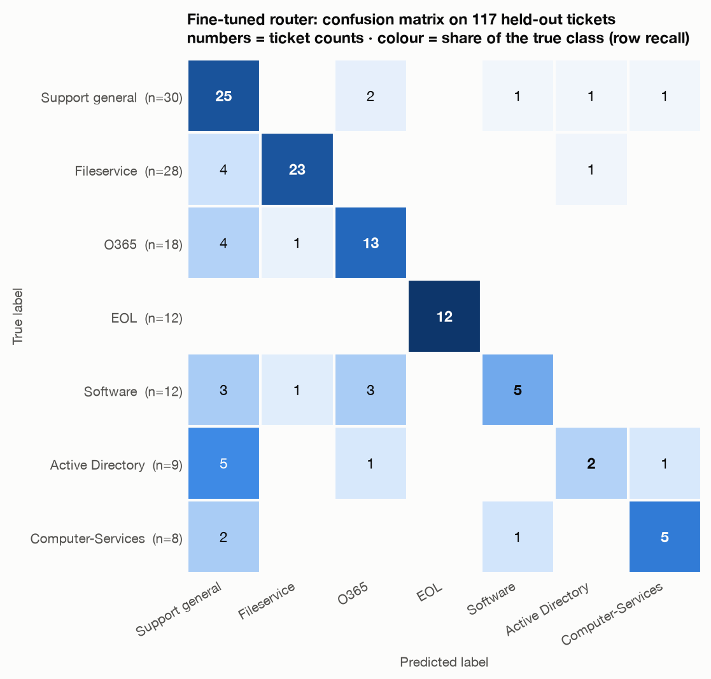

# Support Ticket Router — Fine-tuning Qwen3-1.7B with LoRA

> The Gen Academy · Week 5 project. A general **Qwen3-1.7B-Base** model is fine-tuned with a
> **LoRA adapter (via LLaMA Factory / LLaMA Board)** to route internal IT support tickets to one
> of seven resolver queues. Then it is evaluated against the untrained base model on a held-out
> validation split.

**Status:** ✅ complete, all 7 phases. **Result: 24.8 % → 72.6 % accuracy** on 117 held-out tickets.

**▶ Demo video (5 min, narrated):** [`demo/SupportTicketRouter_demo.mp4`](demo/SupportTicketRouter_demo.mp4) · [chapters & how it was made](demo/README.md)

---

## The business case

An internal IT support team receives tickets via email, Slack and a help portal. Today every
ticket is read by a human before it reaches the right queue. A small fine-tuned model can make
that routing decision first: cheaper and faster than calling a frontier model for every ticket.
**The model never writes a reply.** It predicts one label, and the rest of the tooling takes over.

| Routing label | Downstream queue |
|---|---|
| `Active Directory` | Identity & access: account setup, deactivation, permissions, directory access |
| `Computer-Services` | Endpoint & hardware: devices, printers, workstations, local computer issues |
| `EOL` | Lifecycle: end-of-life, retirement, decommissioning, replacement |
| `Fileservice` | File storage & access: shared drives, folders, file permissions, storage |
| `O365` | Microsoft 365: Outlook, Teams, mailbox, calendar, SharePoint, Office apps |
| `Software` | Application support: installs, licensing, updates, troubleshooting |
| `Support general` | General triage: needs human review / fits no specific queue |

## Approach

| Step | What happens |
|---|---|
| Data | `support_tickets.csv` (585 labelled tickets) → stratified 80/20 train/validation split → ShareGPT JSON registered as `support_tickets` |
| Train | LLaMA Board → `Qwen/Qwen3-1.7B-Base`, dataset `support_tickets`, finetuning type **LoRA** |
| Review | Training loss curve should drop, then level off |
| Merge | Fold the LoRA deltas into the base weights → one standalone model |
| Smoke test | 5 obvious tickets must route correctly |
| Evaluate | Classification report, confusion matrix, baseline (zero-shot A–G letter choice) vs fine-tuned |

**Hardware note:** the course notebook targets a free Colab Tesla T4. This run was done locally
on an **Apple M2 (16 GB unified memory)** using PyTorch's Apple-GPU (`mps`) backend. A
Colab-ready notebook is also included so the run can be repeated on a T4.

## Repository layout

```
.
├── data/
│   ├── raw/support_tickets.csv        # course dataset (585 rows, 7 labels)
│   └── processed/                     # TRAIN.json (ShareGPT), train/val split CSVs
├── notebooks/
│   ├── SupportTicketRouter_end_to_end.ipynb  # course notebook, completed + executed (Colab-ready)
│   └── original/                      # the unmodified course notebook
├── scripts/
│   ├── router_common.py               # shared labels, system prompt, paths
│   ├── check_env.py                   # Phase 1 environment / accelerator check
│   ├── prepare_dataset.py             # Phase 2 split + ShareGPT + dataset_info.json
│   ├── data_report.py                 # Phase 2 balance, leakage, LLaMA-Factory template check
│   ├── llamaboard_train.py            # Phase 3 drives LLaMA Board's Train tab (Playwright)
│   ├── llamaboard_chat.py             # Phase 3 loads the adapter in LLaMA Board's Chat tab
│   ├── phase4_loss_curve.py           # Phase 4 loss curve + convergence check
│   ├── router_inference.py            # course baseline (A–G) + classify(), shared by 5–6
│   ├── phase5_merge_and_smoke.py      # Phase 5 baseline → merge → smoke test
│   ├── phase6_evaluate.py             # Phase 6 full evaluation + charts
│   └── viz_style.py                   # one chart style for all figures
├── configs/                           # LLaMA Board training args          (Phase 3)
├── adapters/                          # trained LoRA adapter               (Phase 3)
├── models.nosync/                     # merged 3.4 GB model, local only    (Phase 5, gitignored)
├── results/                           # metrics, plots, logs               (Phases 1–6)
├── docs/                              # write-ups per phase
├── demo/                              # narrated demo video + LLaMA Board recordings + builder (Phase 7)
├── setup.sh                           # one-shot reproducible setup
└── requirements.txt
```

## Setup

```bash
git clone https://github.com/senthilkumarpackiyam/SupportTicketRouter.git
cd SupportTicketRouter
./setup.sh          # clones LLaMA-Factory @ pinned commit, creates .venv (Python 3.11),
                    # installs deps, downloads Qwen3-1.7B-Base, runs scripts/check_env.py
```

### Reproduce every phase (from the repo root, `.venv` active)

```bash
python scripts/prepare_dataset.py && python scripts/data_report.py   # Phase 2
(cd LLaMA-Factory && GRADIO_SERVER_PORT=7860 llamafactory-cli webui) &   # Phase 3: LLaMA Board
python scripts/llamaboard_train.py                                     #   fill the Train tab, Start, wait
python scripts/llamaboard_chat.py                                      #   try the adapter in the Chat tab
python scripts/phase4_loss_curve.py                                    # Phase 4
python scripts/phase5_merge_and_smoke.py                               # Phase 5 (baseline, merge, smoke test)
python scripts/phase6_evaluate.py                                      # Phase 6
python demo/build/make_demo.py                                         # Phase 7 (macOS)
```

Or open [`notebooks/SupportTicketRouter_end_to_end.ipynb`](notebooks/SupportTicketRouter_end_to_end.ipynb)
in Colab: it clones this repo, so it can evaluate the committed adapter without retraining.

Pinned stack: LLaMA-Factory `f6355ab` (v0.9.6.dev0) · PyTorch 2.15.0 · Transformers 5.8.0 ·
PEFT 0.18.1 · Accelerate 1.11.0 · Gradio 5.50.0 · Python 3.11.

## Project progress

- [x] **Phase 1: Setup:** environment, LLaMA-Factory, base model, repo scaffold → [notes](docs/PHASE1_SETUP.md)
- [x] **Phase 2: Prepare dataset:** stratified split, ShareGPT JSON, `dataset_info.json` → [notes](docs/PHASE2_DATASET.md)
- [x] **Phase 3: Fine-tune via LLaMA Board:** LoRA on Qwen3-1.7B-Base, 90 steps, loss 7.16 → 0.19 in 69 min → [notes](docs/PHASE3_TRAINING.md)
- [x] **Phase 4: Review training:** loss curve falls 97 % and is flat in epoch 3 → no retrain → [notes](docs/PHASE4_TRAINING_REVIEW.md)
- [x] **Phase 5: Merge + smoke test:** baseline 24.8 %, adapter merged (verified), course smoke test 4/5 → [notes](docs/PHASE5_MERGE_SMOKE.md)
- [x] **Phase 6: Evaluate + compare:** 24.8 % → 72.6 % accuracy; report, confusion matrix, comparison, thresholds, latency → [notes](docs/PHASE6_EVALUATION.md)
- [x] **Phase 7: Demo video:** 5 min, Indian English narration, real LLaMA Board footage → [video](demo/SupportTicketRouter_demo.mp4) · [notes](demo/README.md)

## Key findings along the way

- **Chat template (Phases 2–3):** for a *Base* model LLaMA Board leaves the template at
  `default` (`System:/Human:/Assistant:`). LLaMA-Factory then rewrites the tokenizer's chat
  template to match and saves it with the adapter, so inference must load the tokenizer **from the
  adapter folder**, as the course notebook does. Picking `qwen3` by hand instead would make every
  answer start with an empty `<think></think>` block, and the course's `classify()` would label
  **every** ticket `Support general`. [Details](docs/PHASE2_DATASET.md#which-chat-template-does-llama-board-use-corrected-in-phase-3)
- **Training on a 16 GB laptop:** 90 steps took 69 min on the M2 GPU, but step time varied from
  about 33 s to 55 s depending on what else was running (a recording browser, iCloud Drive syncing the
  project folder, swap). Keep the machine idle and the project out of synced folders.
  [Details](docs/PHASE3_TRAINING.md#step-time)
- **Course notebook bug:** `classification_report(..., target_names=LABEL_TOKENS)` is called
  without `labels=`, so sklearn sorts the classes alphabetically and the names are attached to
  the wrong rows (also in the per-class F1 chart). Fixed in this project by passing `labels=`.

## Results

Evaluated on the **117 held-out validation tickets** (stratified 20 %, never seen in training).

| | Base Qwen3-1.7B (zero-shot A–G) | **Fine-tuned (LoRA via LLaMA Board)** |
|---|---|---|
| Accuracy | 24.8 % | **72.6 %** (+47.9 points) |
| Macro F1 | 0.078 | **0.679** |
| Course smoke test | 2 / 5 | **4 / 5** |
| Latency (Apple M2 GPU) | | 278 ms median per ticket |



| Per class (fine-tuned) | Precision | Recall | F1 | n |
|---|---|---|---|---|
| EOL | 1.00 | 1.00 | 1.00 | 12 |
| Fileservice | 0.92 | 0.82 | 0.87 | 28 |
| O365 | 0.68 | 0.72 | 0.70 | 18 |
| Support general | 0.58 | 0.83 | 0.69 | 30 |
| Computer-Services | 0.71 | 0.63 | 0.67 | 8 |
| Software | 0.71 | 0.42 | 0.53 | 12 |
| Active Directory | 0.50 | **0.22** | 0.31 | 9 |



**What the numbers say**

- **Fine-tuning works:** the untrained model picks the first option for almost every ticket.
  After a 69-minute LoRA run that trains 0.5 % of the weights, the model routes 73 % of unseen
  tickets correctly and always answers with a clean label.
- **The weak spot is Active Directory (recall 2/9).** Generic tickets drift to the catch-all
  `Support general` (18 of 32 errors). Part of it is the data: near-identical account requests
  are labelled three different ways in training.
  [Details and next steps](docs/PHASE6_EVALUATION.md#what-to-do-about-active-directory)
- **Use the confidence score:** auto-routing only tickets with confidence ≥ 0.8 handles 44 % of the
  volume at 86 % accuracy and leaves the rest for human triage.
- **Honest context:** a TF-IDF + logistic-regression model reaches 69.2 % on the same split. With
  117 tickets (±8 points), the LLM's lead isn't statistically meaningful. Proving its value would
  need a larger, harder test set.
- The baseline isn't a strawman: the best of four prompt/tokenisation variants reaches only 31.6 %.

## Credits

- Course material and dataset: [The Gen Academy, 5A Fine-Tune a Support Ticket Router](https://github.com/The-Gen-Academy/5A-Fine-Tune-a-Support-Ticket-Router)
- Fine-tuning framework: [LLaMA Factory](https://github.com/hiyouga/LLaMA-Factory)
- Base model: [Qwen/Qwen3-1.7B-Base](https://huggingface.co/Qwen/Qwen3-1.7B-Base)
