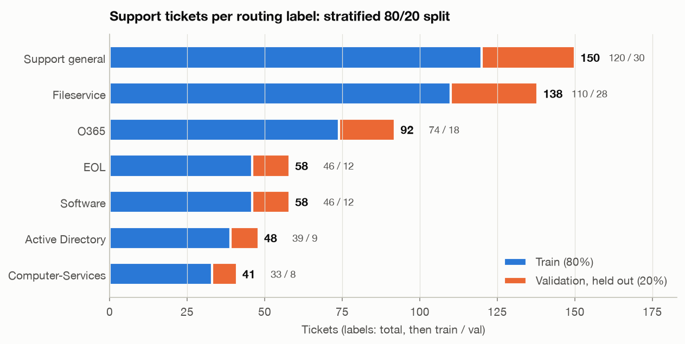

# Phase 2: Prepare the support-ticket dataset

Course equivalent: **"Prepare Support Ticket Dataset"** cell (run locally with
[`scripts/prepare_dataset.py`](../scripts/prepare_dataset.py) instead of the Colab upload widget).
Checks: [`scripts/data_report.py`](../scripts/data_report.py) →
[`results/phase2_data_report.json`](../results/phase2_data_report.json).

## What was done

1. Loaded `data/raw/support_tickets.csv` (585 rows, columns `category_truth`, `text`). All rows
   have one of the 7 known labels; no nulls, no empty texts, no duplicate texts.
2. Shuffled and split **80/20, stratified by label**, `random_state=42` (same seed and order as
   the course notebook, so the split is identical to a Colab run).
3. Converted the **training split only** to ShareGPT JSON → `data/processed/TRAIN.json`:
   ```json
   {"messages": [
     {"role": "system",    "content": "You are an IT helpdesk ticket routing assistant. Given a support ticket, respond with exactly one of the following categories: Support general, Fileservice, O365, EOL, Software, Active Directory, Computer-Services."},
     {"role": "user",      "content": "Support Ticket: <ticket text>"},
     {"role": "assistant", "content": "<label>"}]}
   ```
4. Copied it to `LLaMA-Factory/data/TRAIN.json` and registered it as **`support_tickets`** in
   `LLaMA-Factory/data/dataset_info.json` (entry saved in
   [`data/processed/dataset_info_entry.json`](../data/processed/dataset_info_entry.json)), so
   LLaMA Board lists it in its dataset drop-down.
5. Saved `train_split.csv` (468) and the held-out **`val_split.csv` (117)**.

## Class balance



| Label | Total | Train | Val | Share |
|---|---:|---:|---:|---:|
| Support general | 150 | 120 | 30 | 25.6% |
| Fileservice | 138 | 110 | 28 | 23.6% |
| O365 | 92 | 74 | 18 | 15.7% |
| EOL | 58 | 46 | 12 | 9.9% |
| Software | 58 | 46 | 12 | 9.9% |
| Active Directory | 48 | 39 | 9 | 8.2% |
| Computer-Services | 41 | 33 | 8 | 7.0% |

- The split is properly stratified: no class's share differs by more than **0.6 percentage
  points** between train and validation.
- **Imbalance:** the two largest classes are ~3.5× the two smallest. A model that always says
  `Support general` would already score **25.6 %** accuracy. That is the floor to beat.
- **Small validation classes:** `Active Directory` has 9 validation tickets and
  `Computer-Services` 8, so one mistake moves their recall by 11–12.5 points. Per-class numbers
  for those classes should be read with that in mind.

## Leakage check (train vs validation)

| Check | Result |
|---|---|
| Exact text overlap (case/whitespace-normalised) | **0** |
| Nearest-train-ticket TF-IDF cosine similarity, median / p90 / max | 0.41 / 0.69 / 0.95 |
| Validation tickets with a near-paraphrase in train (sim ≥ 0.8) | **3 of 117** |
| Validation tickets with a close neighbour (sim ≥ 0.6) | 14 of 117 |
| Label agreement of the single most similar train ticket (1-NN) | **64.1 %** |

The dataset contains some templated paraphrases. The most similar pair (0.95) differs only by
"Hi there" / "Thanks!". This is mild (3 tickets) and is a property of the course dataset, so the
split is kept as-is for comparability. It is still worth remembering when reading the final
accuracy. The **1-NN agreement of 64 %** is a useful reference point: a pure word-overlap lookup
already gets about 64 %, so the fine-tuned model should land clearly above that.

**Label ambiguity:** several tickets that sound like account work are labelled `Support general`
rather than `Active Directory`. Example: *"create a light external user account… email access and
basic system access"*, or *"set up a new Windows account for a new team member… email through
Exchange, Skype, and standard file share access"*. The pattern appears to be that **multi-service
onboarding** goes to general triage while single identity tasks go to AD. The model has to learn
that from the labels; expect most errors at the `Support general` ↔ `Active Directory` boundary.

## LLaMA-Factory pipeline check (what training will actually see)

The dataset was loaded through LLaMA-Factory's own SFT data pipeline with LLaMA Board's default
settings (`cutoff_len` 2048, "Enable thinking" on), once for each candidate chat template.

- All **468** examples parse correctly.
- Training sequences are **83–190 tokens** depending on the template (median ≈ 100–107, p95 ≈ 120).
  The default `cutoff_len` of 2048 truncates nothing. Batches are padded only to their longest
  example, so a smaller cutoff would not speed things up either.
- Only the answer tokens carry loss; the system prompt and ticket are masked.

### Which chat template does LLaMA Board use? (corrected in Phase 3)

> **Correction:** the first version of this note assumed LLaMA Board auto-selects the `qwen3`
> template for Qwen3-1.7B-Base. The Phase 3 dry run of the UI showed otherwise: LLaMA Board only
> auto-fills the template for `-Chat / -Instruct / -Distill / -Thinking` models. For a **Base**
> model the *Chat template* field stays **`default`** (`register_model_group` in
> `LLaMA-Factory/src/llamafactory/extras/constants.py`). The analysis below covers all three
> candidates; the conclusion is to **keep LLaMA Board's `default`**.

| Template | Trained sequence (prompt → **answer with loss**) | Prompt = Qwen's original template? | Answer = bare label? |
|---|---|---|---|
| **`default`** (LLaMA Board's choice for Base models) | `System: …<\|endoftext\|>\nHuman: Support Ticket: …<\|endoftext\|>\nAssistant:` → **`Support general<\|endoftext\|>`** | ✗ (own format) | ✓ |
| `qwen3` | `<\|im_start\|>system … <\|im_start\|>assistant\n` → **`<think>\n\n</think>\n\nSupport general<\|im_end\|>`** | ✓ | ✗ (empty think block) |
| `qwen3_nothink` | `<\|im_start\|>system … <\|im_start\|>assistant\n` → **`Support general<\|im_end\|>`** | ✓ | ✓ |

**Why `default` is consistent end-to-end:** the `default` template sets
`replace_jinja_template=True`, so LLaMA-Factory **rewrites the tokenizer's chat template** to
the `System: / Human: / Assistant:` format and saves that tokenizer next to the LoRA adapter. The
course's merge cell loads the tokenizer from the adapter folder (`tok_src = ADAPTER_DIR if
tokenizer.json exists`). `classify()` therefore calls `apply_chat_template` with the *training*
format; verified token-for-token (`check_lf_prompt_equals_hf_default: true`). Rule for Phase 5:
**always load the tokenizer from the adapter folder**, never from `Qwen/Qwen3-1.7B-Base`.
Otherwise the merged model is prompted in ChatML it never saw during training.

### ⚠️ Pitfall: picking `qwen3` by hand breaks the course's `classify()`

Selecting `qwen3` looks like the "right" template for a Qwen3 model, but it is a *reasoning*
template. With no reasoning in the answers, it prepends an **empty `<think>\n\n</think>\n\n`
block to every trained response**, and `qwen3` does *not* rewrite the tokenizer template. Then:

1. `apply_chat_template(..., add_generation_prompt=True)` builds the prompt **without** the think block;
2. the model generates as trained: `<think>\n\n</think>\n\nO365`;
3. `skip_special_tokens=True` does not remove it. **`<think>` / `</think>` are not special
   tokens** in the Qwen3 tokenizer (verified);
4. `generated.startswith(label)` fails for every label, so **every ticket falls back to
   `"Support general"`** (≈ 25.6 % accuracy regardless of training).

If `qwen3` is used, the fix is `apply_chat_template(..., enable_thinking=False)` at inference.
Verified: that appends exactly the trained think block. `qwen3_nothink` avoids the issue entirely.
LLaMA-Factory itself warns about this at load time: *"If the base model is NOT a reasoning model…
please add `_nothink` suffix."*
