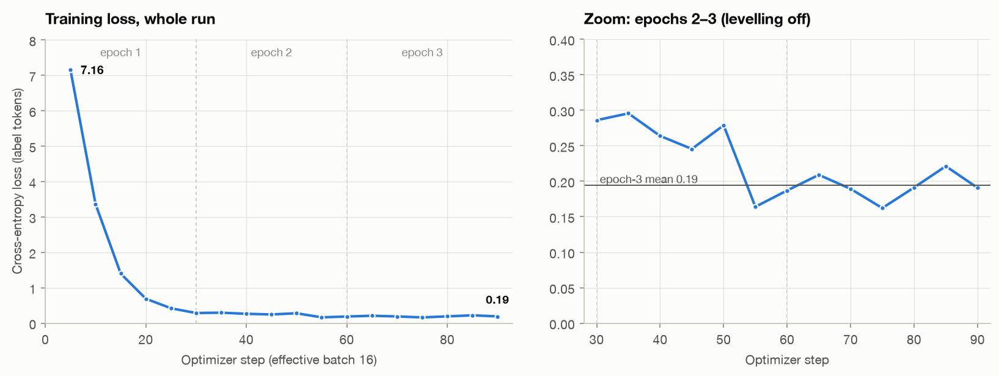

# Phase 4: Review training (loss curve)

Course equivalent: **"Review Training — Loss Curve"**: read `trainer_log.jsonl` from the
adapter folder and check that the loss *falls steadily and then levels off*. A curve that never
drops points to a learning rate that's too high, too little data, or the wrong chat template.

Script: [`scripts/phase4_loss_curve.py`](../scripts/phase4_loss_curve.py). It produces the
course's printout and verdict, plus per-epoch numbers and the slope of the last epoch, so
"levelled off" can be measured.

## Numbers

| | Loss |
|---|---|
| First logged point (step 5) | **7.16** |
| End of epoch 1 (step 30) | 0.29 |
| Epoch 2 mean | 0.24 |
| Epoch 3 mean | 0.19 (range 0.16 – 0.22) |
| Final (step 90) | **0.19** |
| Total drop | 6.97 (**−97 %**) |
| Epoch-3 trend | +0.002 per 10 steps, i.e. flat |

Course verdict (same thresholds as the notebook): **"Loss is low — model has likely converged
well."** Raw values: [`results/phase4_training_review.json`](../results/phase4_training_review.json).

## How to read it

1. **The steep drop (steps 0–20) is the model learning the task format.** The base model has
   never seen `Assistant:` followed by a bare label and `<|endoftext|>`. Only 3–6 tokens per
   ticket carry loss (the label, then the end tokens), so once the format clicks, the loss
   collapses. This takes about 320 tickets, less than one epoch.
2. **Epochs 2–3 are the slow part: telling similar queues apart.** The loss creeps from 0.29 to
   0.19 and then stops improving. Epoch 3 is flat (no downward trend) and has no spikes, so
   training was stable and the cosine schedule ended with the learning rate near zero.
3. **The floor at about 0.19 is expected for this dataset.** Phase 2 found that a ticket's
   nearest neighbour in the training set has the same label only 64 % of the time. Near-identical
   requests carry different labels: *"please set up a new user account"* is labelled Fileservice
   9×, Support general 3× and Active Directory 2×. No model can push the loss on those tickets to
   zero, and if it did, it would be memorising noise.
4. **What the curve can't show: overfitting.** LLaMA Board's default `Val size` is 0, so there
   is no validation loss. The real test is the held-out validation split in Phase 6.

## Decision

**No retraining.** The curve meets the course criterion. It falls steeply, then flattens, with
no instability. Epoch 3 added almost nothing, so more epochs at this learning rate would have
little left to gain, and each extra run costs about 1 hour on this laptop. If Phase 6 shows weak
classes, the levers are a larger LoRA rank / learning rate or relabelling the conflicting
tickets. More epochs aren't one of them.
