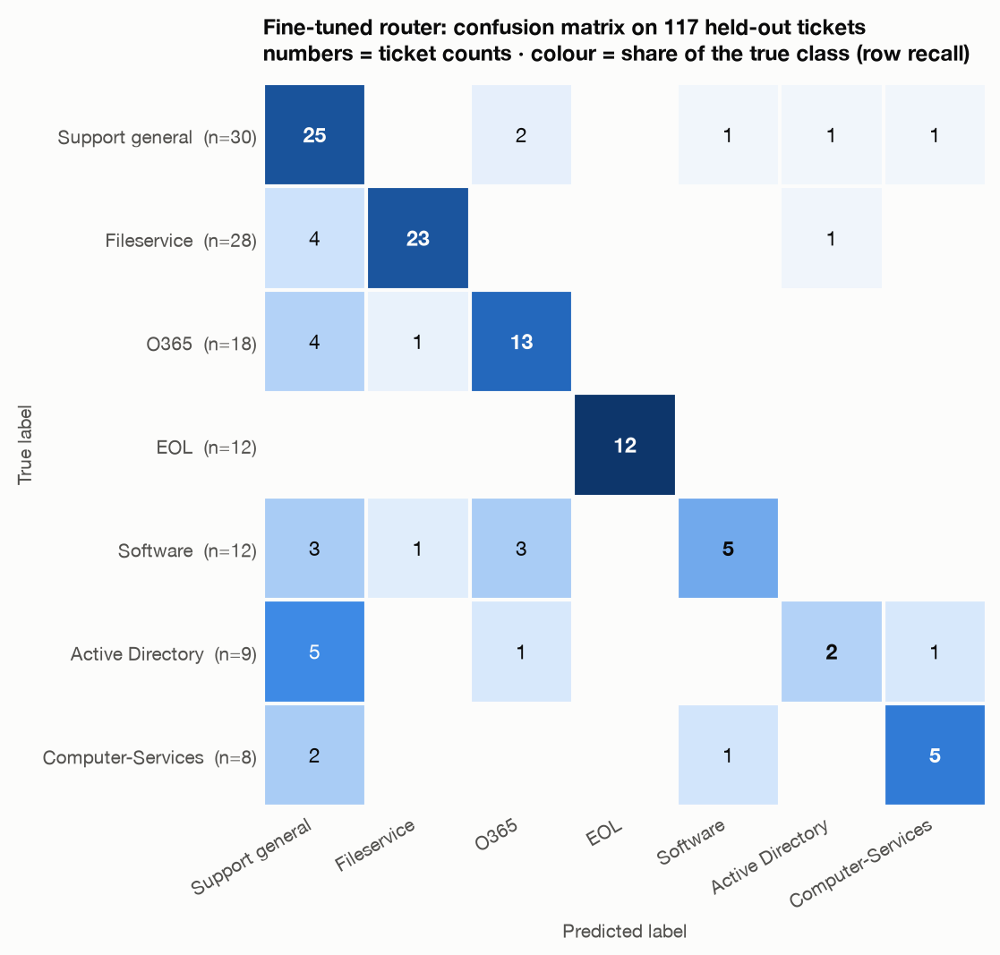
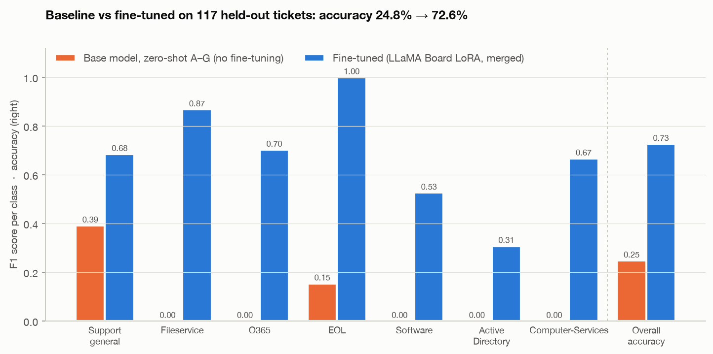
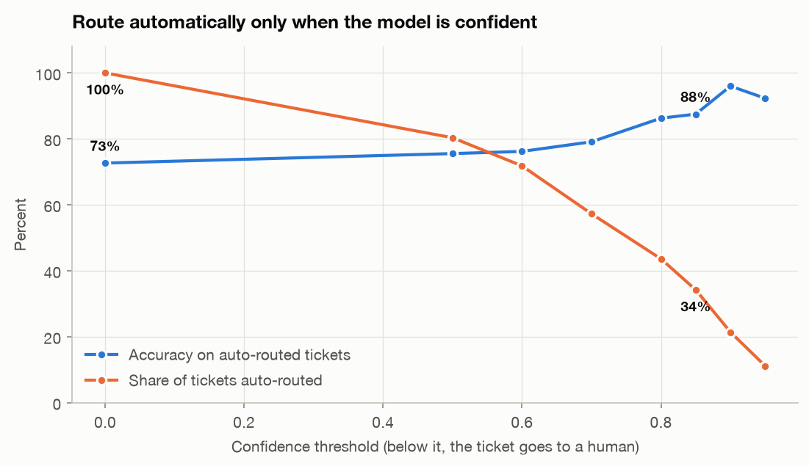

# Phase 6: Evaluate and compare

Course equivalent: **"Evaluate the Fine-tuned Model on the Validation Split"**, **classification
report**, **confusion matrix**, **"Baseline vs Fine-tuned Comparison"**.

* Script: [`scripts/phase6_evaluate.py`](../scripts/phase6_evaluate.py). It loads the **merged**
  model saved in Phase 5 in a fresh process, which also proves the standalone model works.
* Notebook: [`notebooks/SupportTicketRouter_end_to_end.ipynb`](../notebooks/SupportTicketRouter_end_to_end.ipynb)
  is the course notebook, completed and **executed** locally. It reproduces exactly the same numbers
  (baseline 24.8 %, fine-tuned 72.6 %, identical smoke-test confidences), and it runs on Colab too.
* Data: the **117 held-out validation tickets**, which the model never saw during training.
  Per-ticket output is in [`results/phase6_predictions.csv`](../results/phase6_predictions.csv), all
  numbers in [`results/phase6_metrics.json`](../results/phase6_metrics.json), and the run log in
  [`results/phase6_run.log`](../results/phase6_run.log).

## Headline

| | Base model (zero-shot A–G) | **Fine-tuned (LoRA, merged)** |
|---|---|---|
| Accuracy | 24.8 % | **72.6 %** (+47.9 points) |
| Macro F1 | 0.078 | **0.679** |
| Output format | always valid (letter choice) | **117 / 117 clean labels**, no fallback needed |

The +47.9-point gain is inside the course's "typical +40–60 points" range for a short LoRA run on a
small dataset.

## 1. Classification report (fixed)

| Class | Precision | Recall | F1 | Val tickets |
|---|---|---|---|---|
| Support general | 0.581 | **0.833** | 0.685 | 30 |
| Fileservice | **0.920** | 0.821 | **0.868** | 28 |
| O365 | 0.684 | 0.722 | 0.703 | 18 |
| EOL | **1.000** | **1.000** | **1.000** | 12 |
| Software | 0.714 | 0.417 | 0.526 | 12 |
| Active Directory | 0.500 | **0.222** | 0.308 | 9 |
| Computer-Services | 0.714 | 0.625 | 0.667 | 8 |
| **Macro avg / accuracy** | 0.731 | 0.663 | 0.679 | **72.6 %** |

### The course notebook's report has its rows mixed up

The course calls `classification_report(y_true, y_pred, target_names=LABEL_TOKENS)` **without
`labels=`**. sklearn then orders the rows alphabetically but names them in `LABEL_TOKENS` order. On
these predictions, the course version prints **"Active Directory: recall 0.417"** (that row holds
Software's numbers) and **"EOL: 0.868 F1"** (Fileservice's). The real Active Directory recall is
**0.222**. The same bug affects the per-class F1 chart. This project passes `labels=LABEL_TOKENS`
everywhere. Both versions are shown side by side in
[`results/phase6_classification_report.txt`](../results/phase6_classification_report.txt).

## 2. Confusion matrix

* **Strong:** EOL 12/12 (the vocabulary is distinctive: *retire, decommission*), Fileservice
  23/28 with 92 % precision, Support general 25/30.
* **Weak:** **Active Directory 2/9** and Software 5/12.
* **The main failure mode is drifting to `Support general`.** It is predicted 43 times against 30
  true, and **18 of the 32 errors** land there (5 of the 7 Active Directory misses). When a ticket
  is short or generic ("I'm having some trouble with access — could someone help me out?"), the
  model falls back to the catch-all queue, which is also the largest class in training.
* Software → O365 (3 tickets) is plausible confusion: *"I don't have Outlook on my computer, can
  someone install it?"* and two Okta tickets are labelled Software.

The course prints **"Warning: Active Directory recall below 0.85 — consider training longer."**
At 22 % (2 of 9) this is the result's weak spot. The course calls Active Directory the
production-critical queue (a new employee who can't log in on day one). See
[next steps](#what-to-do-about-active-directory).

## 3. Baseline vs fine-tuned

The base model scores 0 F1 on five of seven classes. Fine-tuning taught it everything it knows
about Fileservice, O365, Software, Active Directory and Computer-Services. EOL goes from 0.15 to
1.00.

### Was the baseline handicapped? (sensitivity check)

The course's baseline uses the adapter's tokenizer (`default` template) and the `" A"` letter
tokens. To rule out a template artefact, the same A–G baseline was re-run with **Qwen's original
chat template** and both letter tokenisations:

| Baseline variant | Accuracy | Macro F1 | Share answered "A" |
|---|---|---|---|
| `default` template, `" A"` letters (**course**) | 24.8 % | 0.078 | 97 % |
| `default` template, `"A"` letters | 24.8 % | 0.164 | 42 % |
| Qwen original template, `"A"` letters | 25.6 % | 0.067 | 95 % |
| Qwen original template, `" A"` letters | **31.6 %** | 0.144 | 77 % |

Even the best variant (31.6 %) is about 41 points below the fine-tuned model. The untrained model
mostly picks the first option. The fine-tuning gain doesn't depend on how the baseline is
prompted.

## 4. Context: is a 1.7 B-parameter LLM needed for this?

| Model (same split) | Accuracy | Macro F1 |
|---|---|---|
| Majority class (`Support general`) | 25.6 % | 0.058 |
| Base Qwen3-1.7B, zero-shot A–G | 24.8 % | 0.078 |
| TF-IDF nearest neighbour | 64.1 % | 0.601 |
| TF-IDF + logistic regression (sklearn defaults, no tuning) | 69.2 % | 0.659 |
| **Fine-tuned Qwen3-1.7B (LoRA)** | **72.6 %** | **0.679** |

With only 117 validation tickets, the 95 % confidence interval on 72.6 % is about **±8 points**.
The fine-tuned LLM's lead over a TF-IDF + logistic-regression model is 3.4 points (4 tickets), so
**it isn't statistically meaningful**. On this small, short-ticket dataset, the fine-tuned router
is about as accurate as a well-built classical classifier. The course's argument for the LLM
(robustness to phrasing, negation, multi-intent tickets) is plausible, but this validation set is
too small to show it. Proving it would need a larger and harder test set.

## 5. Confidence: auto-route only when the model is sure

| Route automatically if confidence ≥ | Auto-routed | Accuracy on those | Sent to a human |
|---|---|---|---|
| 0 (always) | 100 % | 72.6 % | 0 |
| 0.70 | 57 % | 79.1 % | 50 |
| 0.80 | 44 % | 86.3 % | 66 |
| 0.85 (course's rule of thumb) | 34 % | 87.5 % | 77 |
| 0.90 | 21 % | 96.0 % | 92 |

The confidence score carries real signal: higher confidence means higher accuracy. A practical
deployment would auto-route confident tickets and leave the rest in the human triage queue. Even at
0.80, that removes 44 % of the manual routing work at 86 % accuracy.

## 6. Latency

| Hardware | Median | p95 |
|---|---|---|
| Apple M2 GPU (`mps`, fp16), 117 tickets | **278 ms** | 363 ms |
| Apple M2 CPU (fp32), 10-ticket sample | 961 ms | 1,286 ms |

Each call is one prompt of about 100 tokens plus 3–6 generated tokens, sequentially, with no
batching or quantisation. The course mentions "~18 ms" per ticket on a CPU instance. That is **not
reproduced here**. Getting close would take int8/int4 quantisation, batching and a server-grade
CPU or GPU. The model is still fast enough for a helpdesk queue (well under a second per ticket on
a laptop).

## 7. Error analysis

All 32 misrouted tickets are listed in [`results/phase6_errors.csv`](../results/phase6_errors.csv),
most confident first. Typical cases:

| Ticket (shortened) | True | Predicted |
|---|---|---|
| Hi, I need to get a new email address set up. | Active Directory | O365 (97 %) |
| Hey, I just got a new computer and need help getting it set up. | Active Directory | Computer-Services (88 %) |
| Hi, I'm having some trouble with access — could someone help me out? | Active Directory | Support general (87 %) |
| Hello, I need a Light (external) user account created … | Active Directory | Support general (68 %) |
| Hi, could you please set up a Light (external) user account … | Support general | O365 (80 %) |
| Hi there, could you help me get a new user account set up? | Fileservice | Support general (79 %) |

Some of these are **labelling inconsistencies**. "Light (external) user account" is labelled
Active Directory in one ticket and Support general in others. "New email address" is labelled
Active Directory, though most people would send it to O365. But not all errors can be blamed on
noisy labels. For each error, the most similar training ticket (TF-IDF) has the model's answer as
its label in only **6 of 32** cases, and the neighbours aren't close (median cosine 0.35). Most
errors are short, generic tickets where the model falls back to the catch-all class.

## What to do about Active Directory

Ordered by expected value:

1. **Write down a labelling rule and relabel**: who owns *new user account*, *light/external
   account*, *new email address*? The training data currently answers that three different ways.
   No hyperparameter fixes that.
2. **Auto-route only above a confidence threshold** (section 5). Low-confidence Active Directory
   tickets then reach a human instead of the wrong queue.
3. **A second, tuned training run**: learning rate is the first lever in the course's tuning table.
   LLaMA Board's default 5e-5 is low for LoRA, and 1e-4 to 2e-4 is common. Add `Val size` 0.1 so
   overfitting is visible, and consider oversampling the 39 Active Directory training tickets.
   Not done here because the deadline was close; each run costs about 1 hour on this laptop.
